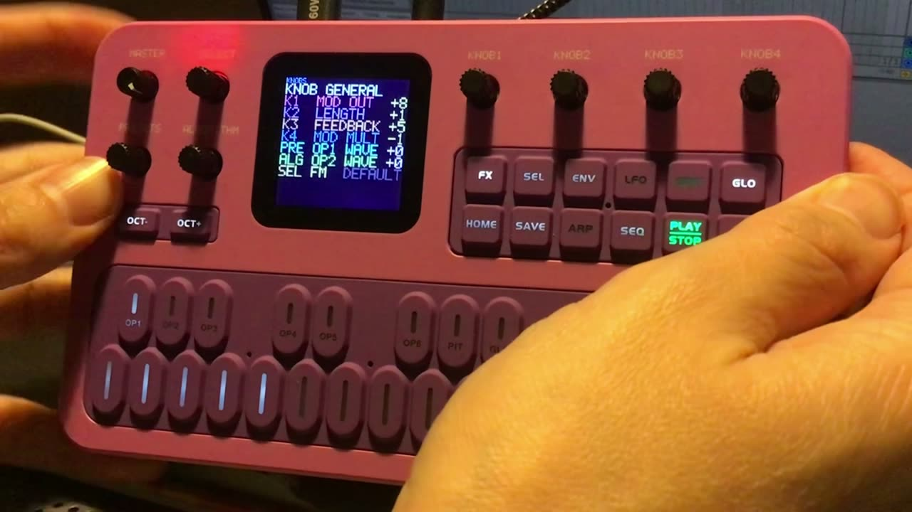
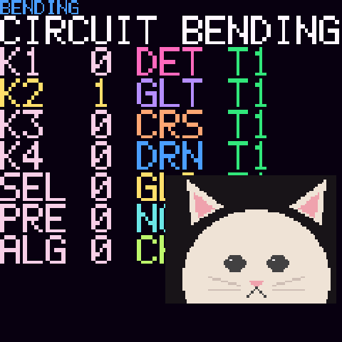
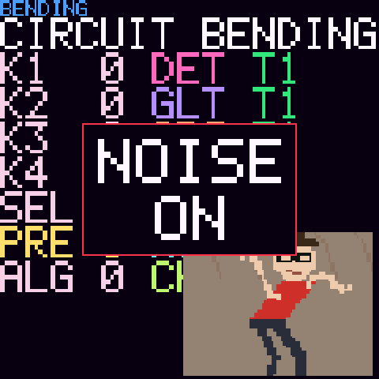
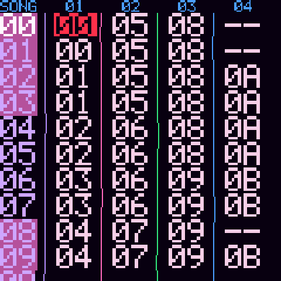
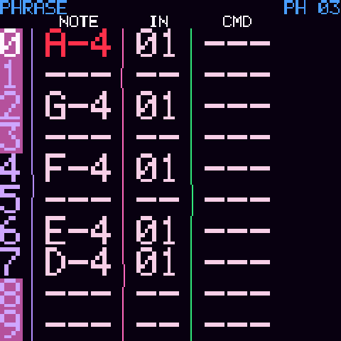
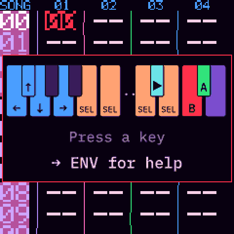
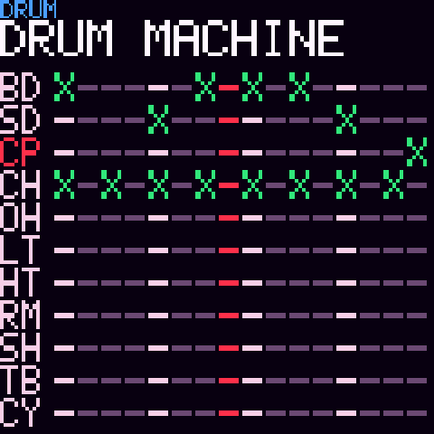

# OPLBend Tracker

A free OPL3 FM tracker firmware, with FX inspired by circuit bending, a drum machine and a looper, for the **M-VAVE FM-1**.

**[Website and web installer →](https://mazmusique.fr/oplbendtracker/)**

- LSDJ-style tracker (SONG, CHAIN, PHRASE, INSTR, TABLE) on a software OPL3 (YMF262) FM engine, 18 voices
- FX inspired by circuit bending, GLITCH, MASTER FX, KNOB GENERAL, drum machine, drum keyboard, looper
- Opens and exports AdLib Tracker II `.A2M` songs, which also open in AMBER OPL Tracker and my other OPL3 trackers
- USB audio into your DAW
- Help on the device: press ENV

## Demo

*Click to watch the demo on the website.*

## Screenshots

## Help

It works like LSDJ, M8 Tracker or Little Piggy Tracker. **First press GLO to switch to D-PAD mode**: the keys become arrows, A, B and SELECT, and the shortcuts below work. Press **ENV** for the help on the device.

- SEL+UP: project · SEL+RIGHT / SEL+LEFT: song → chain → phrase → instrument → table · SEL+DOWN: drum machine
- A: insert · A, A: insert a new one · A+LEFT/RIGHT: value ±1 · A+UP/DOWN: value ±16 · A+B: delete
- SEL+B: select · B: copy · SEL+A: paste · SEL+B+A: deep clone · PLAY: play/stop

## Install

We recommend running the **official firmware V15** on your FM-1 first: M-VAVE now ships V16, but FM-1 custom firmwares are generally installed over V15, and we cannot be sure installing over V16 works.
Then open the [web installer](https://mazmusique.fr/oplbendtracker/installer/) in Chrome or Edge, with the FM-1 on USB,
or use `tools/fm1_install.py`. Use it at your own risk.

To send `.A2M` or `.OBT` songs to the FM-1, or copy its songs back to your computer, use the [song transfer page](https://mazmusique.fr/oplbendtracker/transfer/) (Chrome or Edge).

## Build

`./build.sh` builds `build/tracker.fwsc`. `web/make_site.py` builds the site in `docs/`.

## Support

OPLBend Tracker is free. If you'd like to support its development, you can:

- make a donation on [Ko-fi](https://ko-fi.com/audren) (a donation website, no account needed);
- or buy my music on [Bandcamp](https://mazhootmusic.bandcamp.com): I am also a musician, under the name Maz Hoot.

## Credits and licence

GPL-3.0 (`LICENSE`). By Audren. Built on [Felucca](https://github.com/hugelton/Felucca)
by Leo Kuroshita (@kurogedelic), Hügelton Instruments. The looper's recording (the free take) is adapted from
[SLOOP](https://github.com/isod89/sloop-fm1) by isod89 (GPL-3.0). The `.A2M` format and the instrument presets come from
[AdLib Tracker II](https://www.adlibtracker.net). The package holds three JieLi AC79 SDK files (Apache-2.0). Font: IBM Plex Mono (SIL OFL 1.1).
M-VAVE and FM-1 are trademarks of their respective owners; this project is not affiliated with M-VAVE.

---

**FR** — Un firmware tracker FM OPL3 gratuit, avec des effets inspirés du circuit bending, une boîte à rythmes et un looper, pour le M-VAVE FM-1. Nous conseillons d'installer d'abord
la V15 officielle sur le FM-1 ; ensuite, installe-le depuis le [site](https://mazmusique.fr/oplbendtracker/) (Chrome ou Edge).
